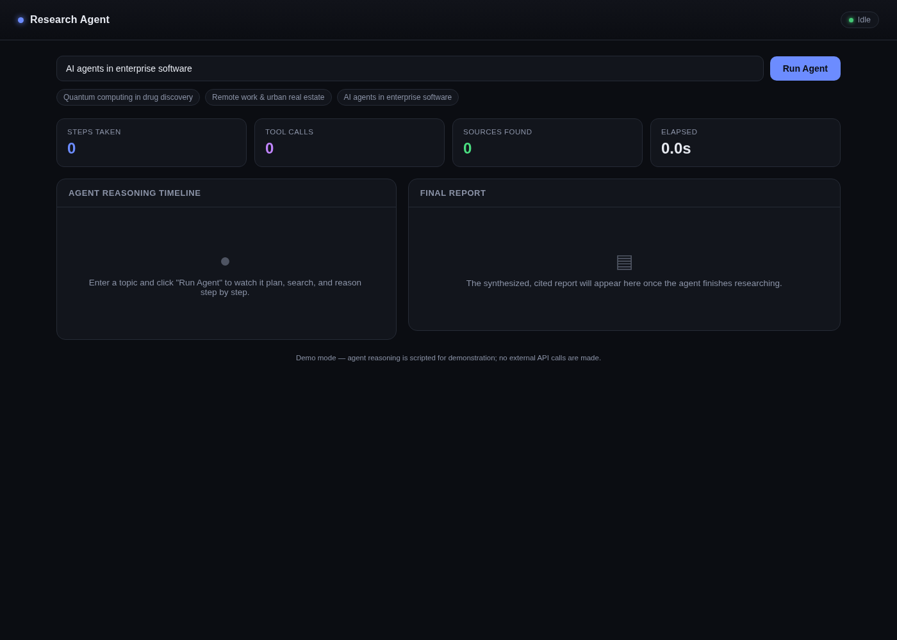
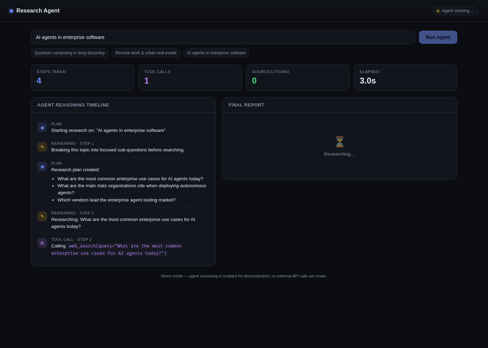
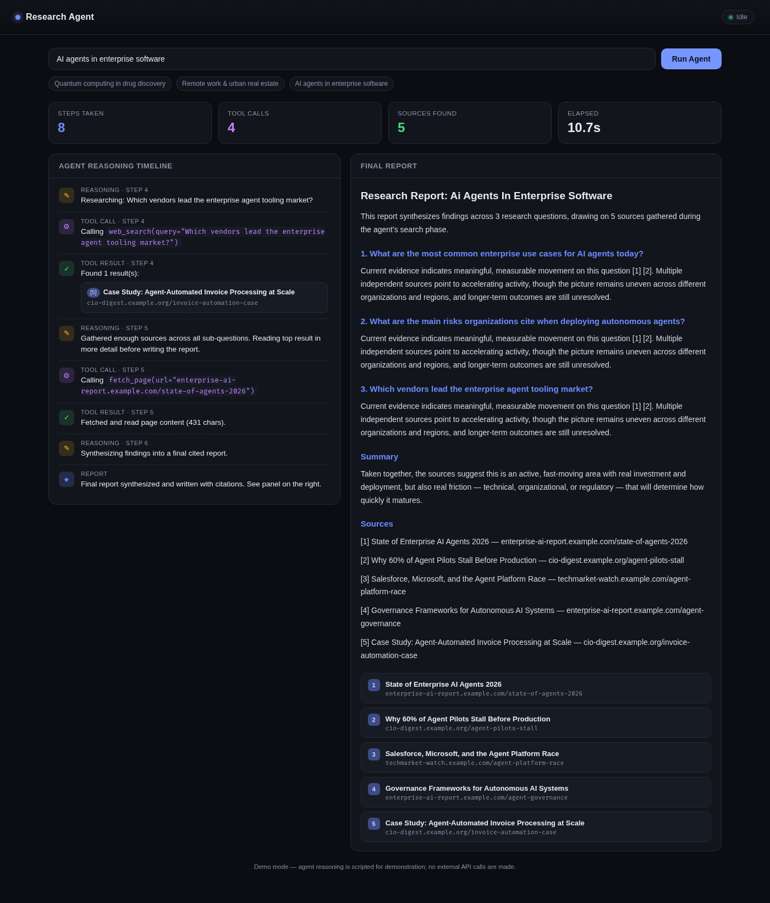

# Research Agent

A small autonomous research agent with a live dashboard. Give it a topic and
it plans sub-questions, "searches the web" and reads sources, then
synthesizes a cited report — while a dashboard shows its reasoning,
tool calls, and sources as they happen.

This is a **demo/dummy build**: the agent's step sequence (planning,
search results, page reads, and the final report) is scripted rather than
calling a live LLM or search API, so it can be run and demonstrated with
zero setup, no API keys, and no external network calls. The code is
structured so the scripted parts (`agent_core()` in `backend.py`) could be
swapped for a real LLM call (e.g. an Ollama or Claude API call with tool
use) and a real search API (e.g. Tavily) without changing the event
protocol or the frontend at all.

## Why this project

The goal was a project that clearly demonstrates the agentic workflow
pattern — **plan → act (tool calls) → observe → synthesize** — in a way
that's easy to see and screenshot, without needing paid API access to run
or demo.

## Agent workflow

1. **Plan** — the agent breaks the research topic into 2–3 focused
   sub-questions.
2. **Act (tool call)** — for each sub-question, it calls a `web_search`
   tool and gets back titled, cited results.
3. **Observe** — results are added to a running source list, deduplicated
   by URL, and numbered for citation.
4. **Deeper read** — the agent calls a `fetch_page` tool on its most
   promising result for more detail.
5. **Synthesize** — the agent writes a final markdown report with inline
   `[1]`, `[2]` citations tied back to the numbered source list.

Every step emits an event over Server-Sent Events (SSE) to the dashboard,
so the UI renders the agent's reasoning timeline live, not just the final
output.

## Tech stack

- **Backend:** Python 3, standard library only (`http.server`, no
  framework) — serves the dashboard and streams agent events over SSE at
  `/api/run`.
- **Frontend:** a single static HTML/CSS/JS dashboard (no build step,
  no framework) that consumes the SSE stream and renders a live timeline,
  stats, and the final cited report.
- **Agent "model":** a scripted step generator standing in for an LLM
  tool-use loop (see `backend.py` docstring for how to wire up a real one).

## Running it

```bash
python3 backend.py
# open http://localhost:8000
```

Type a topic (or click one of the sample chips) and click **Run Agent**.

## Dashboard

| Idle | Running | Report |
|---|---|---|
|  |  |  |

## Project structure

```
research-agent/
  backend.py            # stdlib HTTP server + scripted agent loop + SSE
  frontend/
    index.html           # dashboard UI (vanilla JS/CSS, no build step)
  screenshots/           # dashboard screenshots used in the report
```
